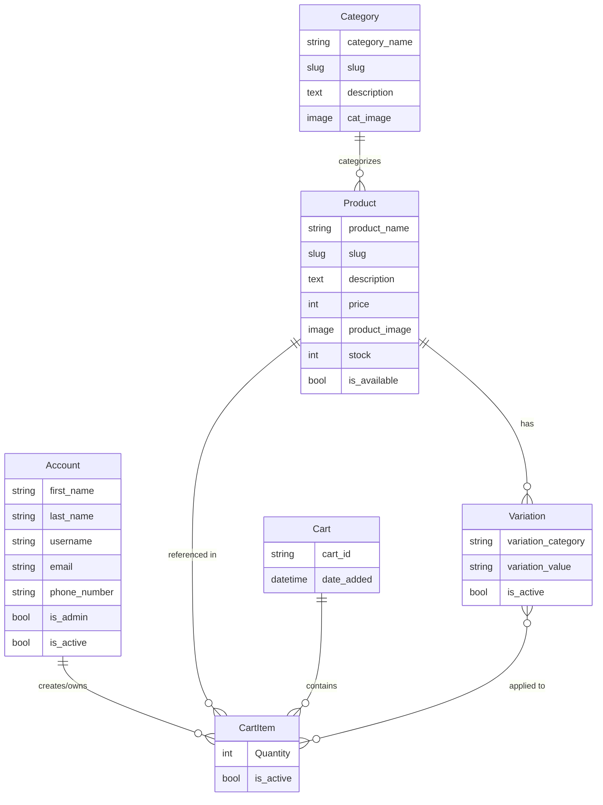

# 🛍️ Django E-Commerce Platform

A robust, modern full-stack e-commerce web application built with **Python**, **Django**, and **Bootstrap 4**. This platform features custom user authentication, a dynamic product catalog with multi-attribute variations (such as color and size), category-based filtering, keyword search, session-based cart management, tax calculations, and an intuitive, responsive storefront.

---

## 📑 Table of Contents

- [Key Features](#-key-features)
- [Tech Stack](#-tech-stack)
- [Project Architecture](#-project-architecture)
- [Database Models](#-database-models)
- [Getting Started](#-getting-started)
  - [Prerequisites](#prerequisites)
  - [Installation & Setup](#installation--setup)
  - [Running the Development Server](#running-the-development-server)
- [Application URL Structure](#-application-url-structure)
- [Admin Management](#-admin-management)
- [Roadmap & Planned Enhancements](#-roadmap--planned-enhancements)
- [Contributing](#-contributing)
- [License](#-license)

---

## ✨ Key Features

### 🔐 Custom User Authentication (`accounts`)
- **Custom Account Model**: Extends `AbstractBaseUser` with **Email** as the primary login credential instead of standard usernames.
- **Registration & Validation**: Clean user signup flow capturing first name, last name, phone number, email, and securely hashed passwords.
- **Custom Account Manager**: Streamlined user and superuser creation with granular permission controls (`is_admin`, `is_staff`, `is_active`, `is_superadmin`).
- **User Dashboard Views**: Templates and route handlers prepared for user registration, login, and profile operations.

### 📦 Product Catalog & Dynamic Variations (`store`)
- **Rich Product Listings**: Displays available products, pricing, stock count, product images, and descriptions.
- **Product Variations**: Dynamic support for multi-attribute product variants (e.g., Color, Size) handled through the `Variation` model and dedicated `VariationManager`.
- **Category Filtering**: Browse products seamlessly filtered by category slugs (`/store/category/<category_slug>/`).
- **Search System**: Multi-field search functionality querying product names, descriptions, and slugs via Django `Q` objects.
- **Pagination**: Built-in pagination dividing large catalogs into easy-to-navigate pages (default: 6 products per page).
- **Product Detail View**: Dedicated product pages showing stock status, pricing, interactive variation dropdowns, and live cart status indicators.

### 📂 Category Management (`category`)
- Hierarchical category structure with slugified SEO-friendly URLs.
- Category image banners and metadata descriptions.
- **Global Context Processor**: `category.context_processors.menu_links` exposes all active categories to the navigation bar across every page.

### 🛒 Shopping Cart System (`carts`)
- **Session-Based Cart**: Tracks cart items using session keys (`_cart_id`), allowing guests to add and manage items before logging in.
- **Variation-Aware Line Items**: Groups cart items by unique product variation combinations (e.g., Large Blue Shirt vs. Medium Red Shirt appear as separate line items).
- **Real-Time Cart Operations**:
  - Add products with selected variations.
  - Increment and decrement quantities directly in the cart view.
  - Remove specific line items or empty quantities.
- **Tax & Total Calculations**: Computes item sub-totals, applies percentage-based tax (2%), and calculates grand totals dynamically.
- **Cart Counter Badge**: `carts.context_processors.counter` maintains an accurate item count displayed in the navbar badge across all pages.

### 🎨 Responsive Frontend & UI/UX
- Responsive design tailored for mobile, tablet, and desktop screens.
- Styled using **Bootstrap 4**, **Font Awesome 5**, and custom CSS.
- Componentized Django templates with modular inheritance (`base.html`, `navbar.html`, `footer.html`).

---

## 🛠️ Tech Stack

- **Backend Framework**: [Django](https://www.djangoproject.com/) (Python 3.x)
- **Database**: SQLite3 (default for development; switchable to PostgreSQL/MySQL)
- **Image Processing**: [Pillow](https://python-pillow.org/)
- **Frontend**: HTML5, CSS3, JavaScript, [jQuery](https://jquery.com/), [Bootstrap 4](https://getbootstrap.com/), [Font Awesome 5](https://fontawesome.com/)
- **Architecture**: Model-View-Template (MVT)

---

## 🏗️ Project Architecture

```plaintext
Ecommerce/
├── accounts/               # Custom user model, registration, authentication & forms
│   ├── forms.py            # Registration and authentication form definitions
│   ├── models.py           # Custom Account & AccountManager models
│   ├── urls.py             # User auth routes (login, register, logout)
│   └── views.py            # User registration and authentication views
├── board/                  # Store landing page & static asset hub
│   ├── static/             # Static CSS, JS, fonts, and brand assets
│   ├── urls.py             # Root homepage route ('/')
│   └── views.py            # Home view rendering popular products
├── carts/                  # Shopping cart management & session tracking
│   ├── context_processors.py# Global cart count badge processor
│   ├── models.py           # Cart and CartItem models
│   ├── urls.py             # Cart operation routes (add, remove, view)
│   └── views.py            # Cart item logic, tax, and total computation
├── category/               # Product category hierarchy
│   ├── context_processors.py# Global menu category links processor
│   ├── models.py           # Category model and slug generation
│   └── views.py            # Category views
├── store/                  # Product catalog, variations, search & details
│   ├── models.py           # Product and Variation models
│   ├── urls.py             # Store, detail, category filter, and search routes
│   └── views.py            # Product query logic, pagination, search filter
├── templates/              # Django HTML templates
│   ├── accounts/           # User login and registration templates
│   ├── includes/           # Reusable partials (navbar, footer)
│   ├── store/              # Cart, product detail, and store catalog templates
│   ├── base.html           # Main base layout wrapper
│   └── home.html           # Landing page template
├── mediafiles/             # User-uploaded assets (product & category images)
├── staticfiles/            # Collected production static files
├── ecom/                   # Django project configuration
│   ├── settings.py         # Application settings, middleware, database config
│   ├── urls.py             # Root URL routing dispatcher
│   └── wsgi.py             # WSGI web server gateway interface
├── manage.py               # Django CLI management utility
└── requirements.txt        # Python dependency manifest
```

---

## 🗄️ Database Models



---

## 🚀 Getting Started

### Prerequisites

Ensure you have the following installed on your machine:
- **Python 3.10+** (tested with Python 3.10, 3.11, 3.12+)
- **Git**
- **pip** (Python package installer)

---

### Installation & Setup

1. **Clone the repository**:
   ```bash
   git clone https://github.com/Joniman478/Ecommerce.git
   cd Ecommerce
   ```

2. **Create a virtual environment**:
   - On **macOS/Linux**:
     ```bash
     python3 -m venv env
     source env/bin/activate
     ```
   - On **Windows (PowerShell)**:
     ```powershell
     python -m venv env
     .\env\Scripts\Activate.ps1
     ```
   - On **Windows (Command Prompt)**:
     ```cmd
     python -m venv env
     env\Scripts\activate.bat
     ```

3. **Install dependencies**:
   ```bash
   pip install -r requirements.txt
   ```

4. **Apply database migrations**:
   ```bash
   python manage.py makemigrations
   python manage.py migrate
   ```

5. **Create a Superuser (Admin)**:
   ```bash
   python manage.py createsuperuser
   ```
   Follow the prompts to enter your first name, last name, username, email, and password.

---

### Running the Development Server

Start the local Django development server:

```bash
python manage.py runserver
```

Open your browser and navigate to:
- **Storefront**: [http://127.0.0.1:8000/](http://127.0.0.1:8000/)
- **Store Catalog**: [http://127.0.0.1:8000/store/](http://127.0.0.1:8000/store/)
- **Admin Control Panel**: [http://127.0.0.1:8000/admin/](http://127.0.0.1:8000/admin/)

---

## 🌐 Application URL Structure

| URL Pattern | View / Description | App |
| :--- | :--- | :--- |
| `/` | Homepage with featured popular products | `board` |
| `/store/` | Full product catalog with pagination | `store` |
| `/store/category/<category_slug>/` | Products filtered by category | `store` |
| `/store/category/<category_slug>/<product_slug>/` | Detailed product page with variation selector | `store` |
| `/store/search/?keyword=<query>` | Product search across title, slug, and description | `store` |
| `/cart/` | Shopping cart overview with tax & grand total | `carts` |
| `/cart/add_cart/<product_id>/` | Add product and selected variations to cart | `carts` |
| `/cart/remove_cart/<product_id>/<cart_item_id>/` | Decrement product quantity in cart | `carts` |
| `/cart/remove_cart_item/<product_id>/<cart_item_id>/` | Completely remove item from cart | `carts` |
| `/accounts/register/` | Customer account registration | `accounts` |
| `/accounts/login/` | Customer login view | `accounts` |
| `/admin/` | Django Administration dashboard | `django.contrib.admin` |

---

## ⚙️ Admin Management

The Django admin panel is customized for full control over store inventory and user accounts:
- **Accounts**: Manage custom user accounts with customized list views, filters, and read-only password handling.
- **Categories**: Automatically pre-populate category slugs from category titles.
- **Products**: Manage prices, stock counts, availability status, category assignments, and media uploads.
- **Variations**: Configure available options such as colors and sizes for each product.
- **Carts & Cart Items**: Inspect guest sessions, active carts, and line items.

---

## 🗺️ Roadmap & Planned Enhancements

- [ ] **Payment Gateways**: Integrate Stripe and PayPal checkout flows.
- [ ] **Order Management**: Order placement, order status tracking, and printable PDF invoices.
- [ ] **Email Verification**: Account activation tokens via SMTP email.
- [ ] **User Dashboard**: Order history, shipping address management, and password reset flows.
- [ ] **Product Reviews & Ratings**: Allow verified buyers to submit star ratings and written feedback.
- [ ] **Wishlist**: Allow customers to save favorite items for future purchase.

---

## 🤝 Contributing

Contributions, issues, and feature requests are welcome!

1. Fork the Project
2. Create your Feature Branch (`git checkout -b feature/AmazingFeature`)
3. Commit your Changes (`git commit -m 'Add some AmazingFeature'`)
4. Push to the Branch (`git push origin feature/AmazingFeature`)
5. Open a Pull Request

---

## 📄 License

Distributed under the MIT License. See `LICENSE` for more information.

